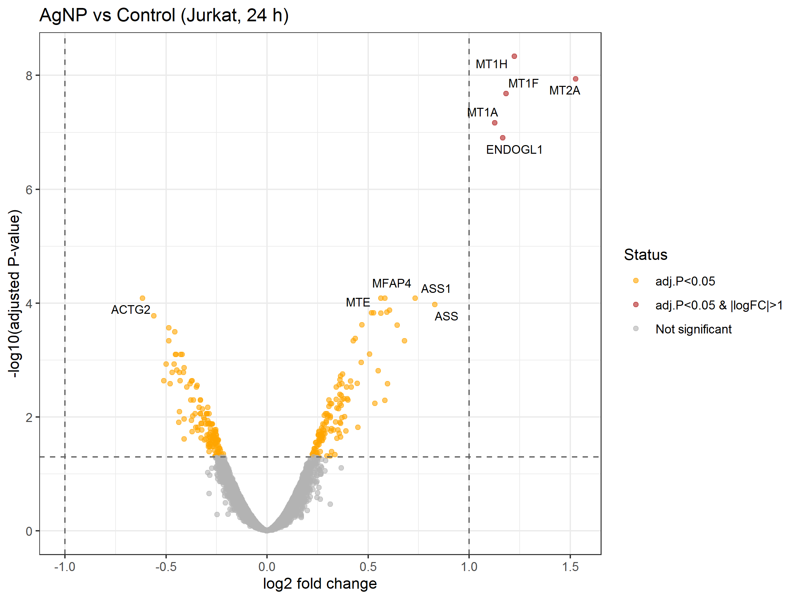
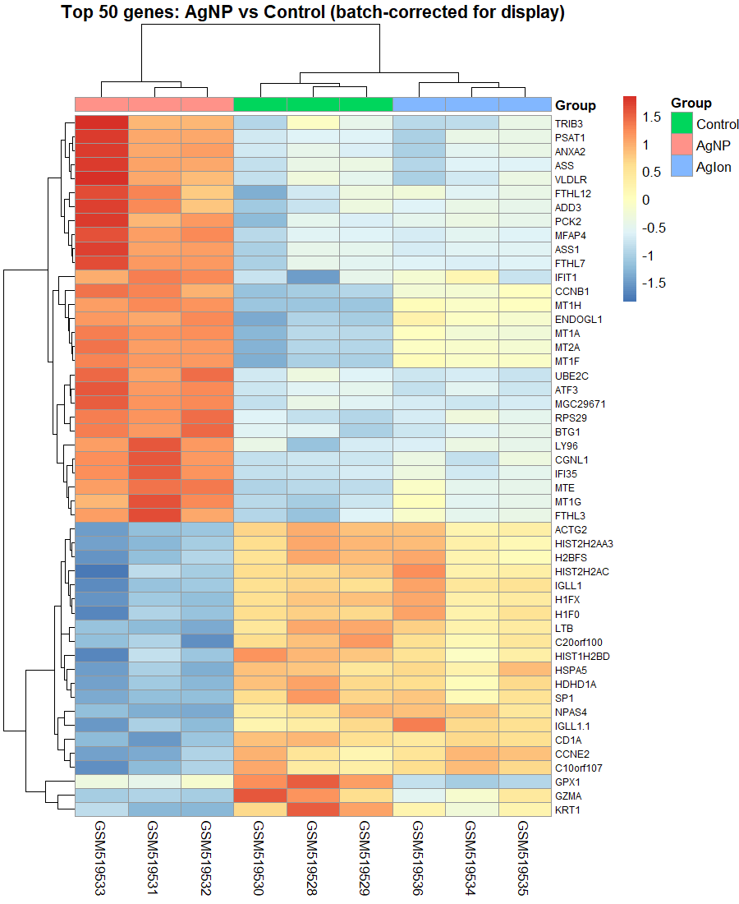
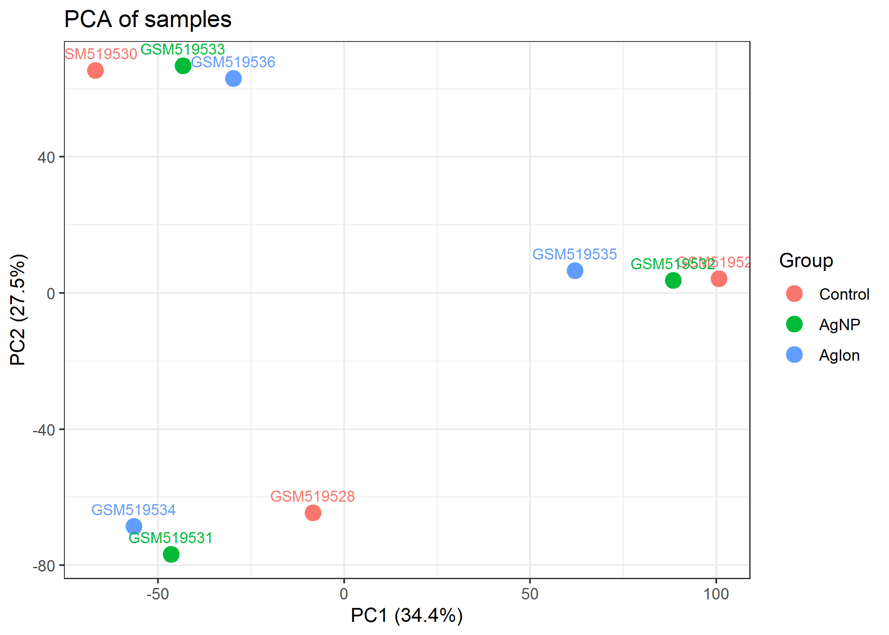

# Transcriptomic response of Jurkat T cells to silver nanoparticles (GSE20692)

Differential expression analysis of public microarray data using R and limma.

## Question
Which genes and pathways respond to silver nanoparticles (AgNPs) in human T cells, and how does the response differ from that of silver ions (Ag+)?

## Dataset
- GEO: GSE20692 (https://www.ncbi.nlm.nih.gov/geo/query/acc.cgi?acc=GSE20692), Illumina platform GPL6883 (mRNA)
- Jurkat cells, 24 h exposure
- 3 groups (Control, AgNP, Ag+) x 3 replicates = 9 samples
- Data were already log2-transformed and quantile-normalised by the original authors

## Methods
1. Download with GEOquery (scripts/01_download_data.R)
2. Quality control: boxplot, density, PCA, sample correlation (scripts/02_explore_and_qc.R)
3. Differential expression with limma, BH-adjusted p-values (scripts/03_differential_expression.R)
4. GO Biological Process enrichment with clusterProfiler (scripts/04_enrichment.R)
5. Volcano plot and heatmap (scripts/05_figures.R)

**Batch effect:** PCA showed samples clustering by replicate number rather than by treatment. Replicate was therefore included as a covariate in the linear model. This is inferred from the data pattern, not from the study documentation.

## Key results
- Strict threshold (adj.P < 0.05, |log2FC| > 1), AgNP vs Control: 5 up-regulated probes (MT1H, MT2A, MT1F, MT1A, ENDOGL1), consistent with the original publication.
- Lenient threshold (adj.P < 0.05), counted as probes: AgNP vs Control 126 up / 131 down; Ag+ vs Control 5 up / 1 down; AgNP vs Ag+ 130 up / 110 down.
- GO enrichment (Biological Process) used one probe per gene (10,386 genes as background). 115 up- and 124 down-regulated genes gave 42 and 21 significant terms.
  - Up-regulated genes were dominated by responses to metal ions (zinc, copper, cadmium) and detoxification. These terms are likely driven by the metallothionein genes themselves, so they are not independent of the MT finding above.
  - Down-regulated genes were enriched for immune effector processes, cell killing and regulation of the G1/S transition. The evidence is weaker and should be treated as hypothesis-generating.

## Limitations
- Only 3 replicates per group, so p-values and effect sizes should be interpreted cautiously.
- One cell line (Jurkat) and one time point (24 h).
- Probe-to-gene mapping uses the platform annotation. No wet-lab validation.

## Reproducing
Open the .Rproj file and run the scripts in the scripts folder in order (00 to 05).
Packages: GEOquery, limma, ggplot2, ggrepel, pheatmap, clusterProfiler, org.Hs.eg.db, enrichplot.